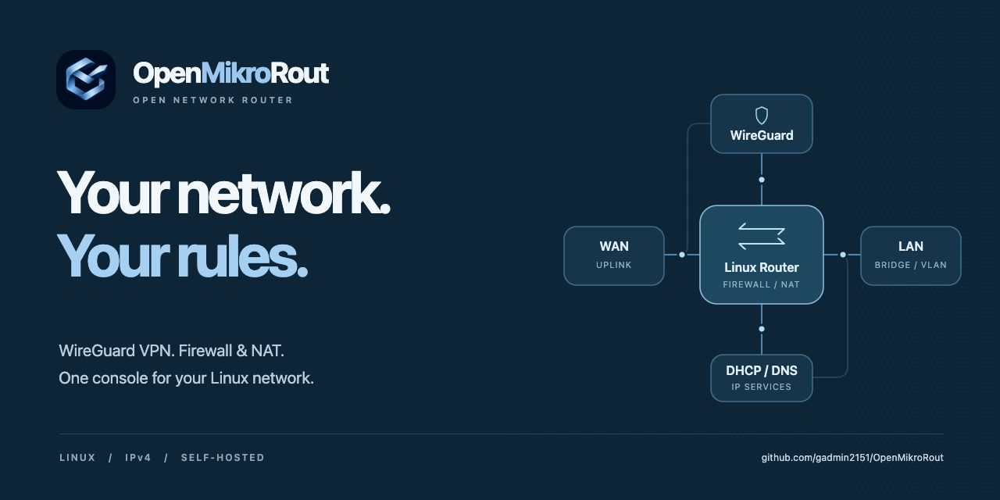
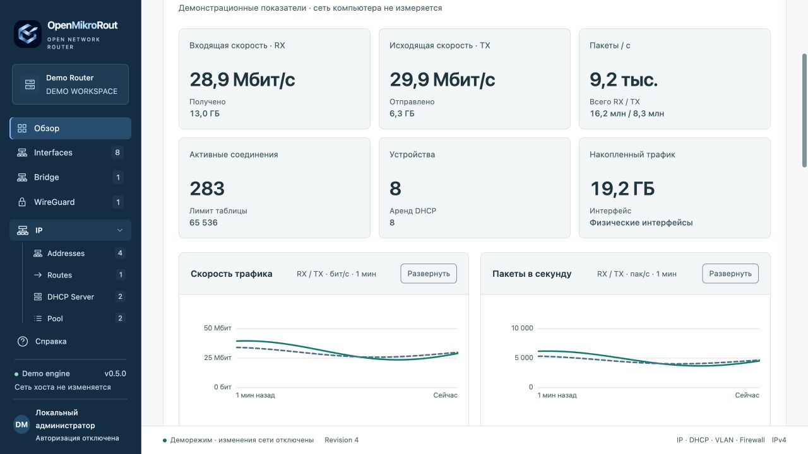
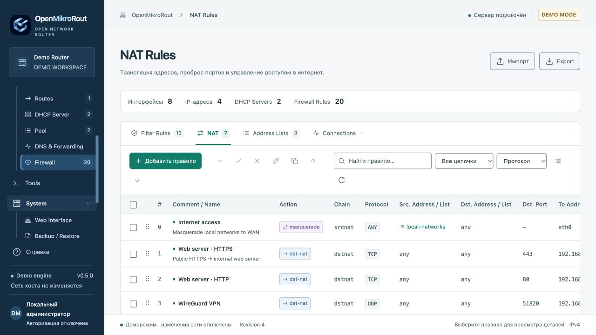
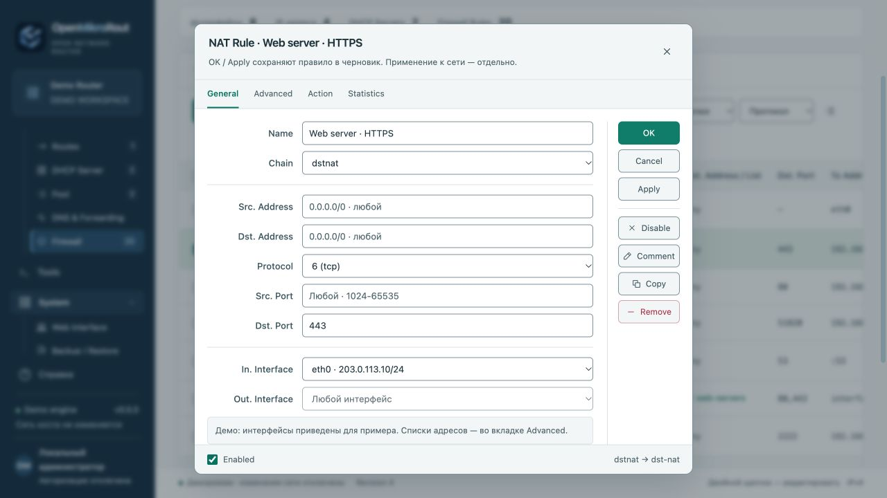
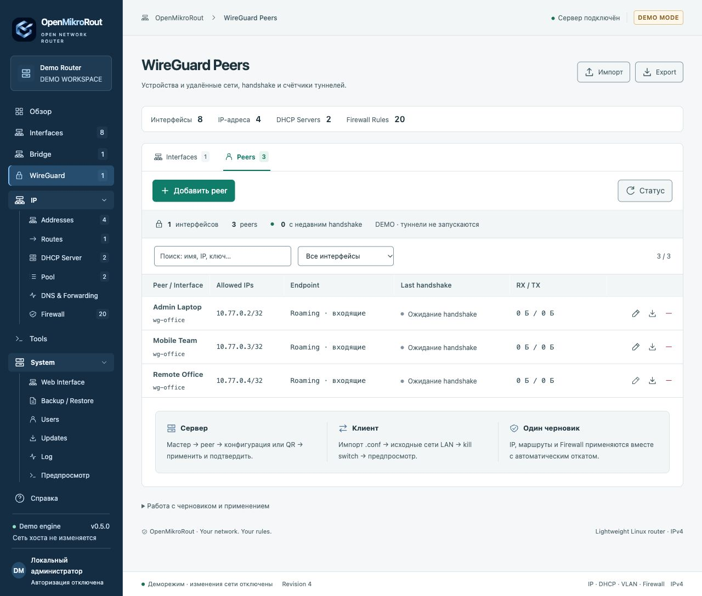
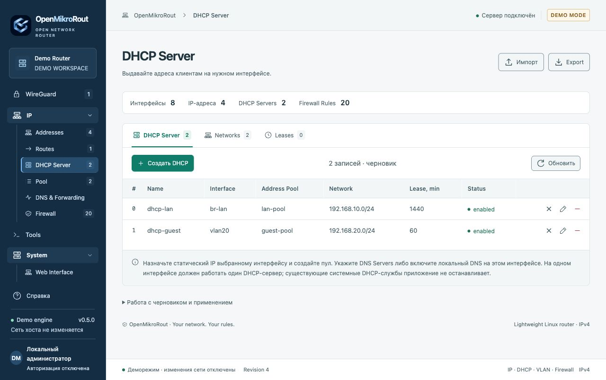
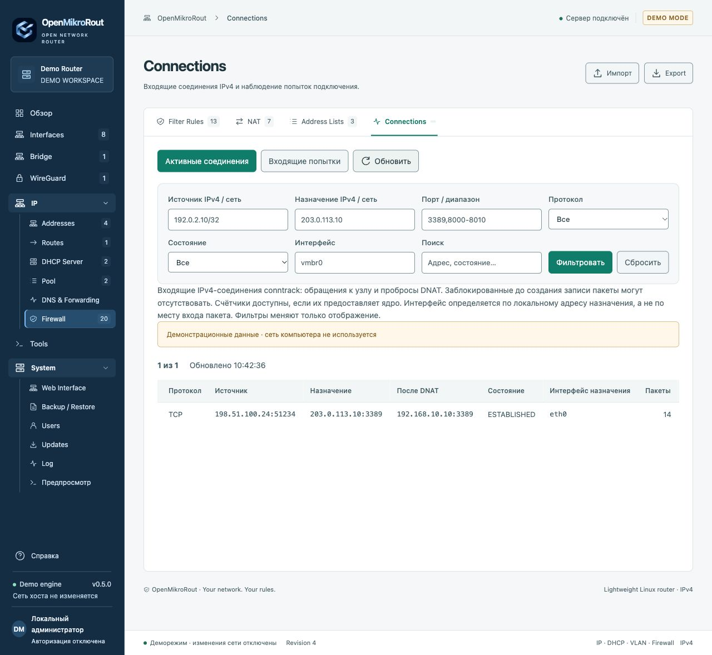
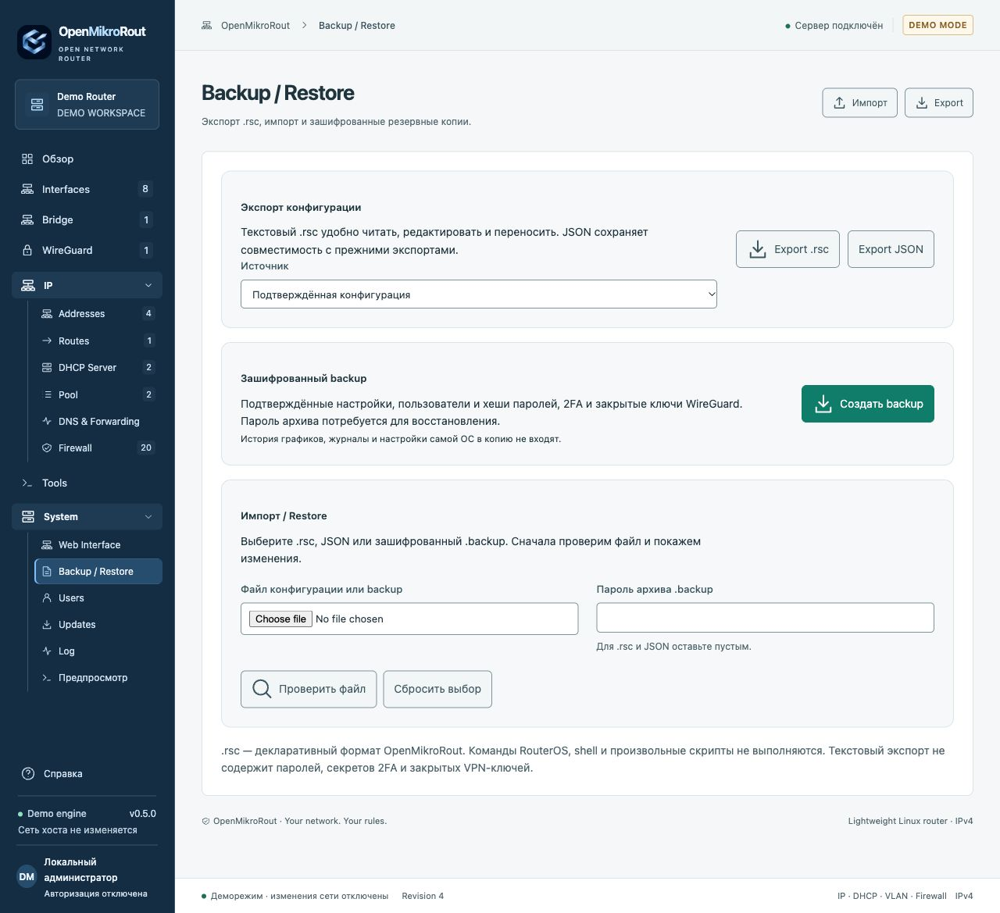

<h1 align="center">
  
</h1>

<p align="center">
  <a href="https://github.com/gadmin2151/OpenMikroRout/releases/latest"></a>
  <a href="https://github.com/gadmin2151/OpenMikroRout/actions/workflows/ci.yml"></a>
  
  
  
</p>

<p align="center"><a href="README.md">Русский</a> · <b>English</b></p>

<p align="center">
  <a href="#capabilities">Capabilities</a> ·
  <a href="#interface">Screenshots</a> ·
  <a href="#quick-start">Try the demo</a> ·
  <a href="#documentation">Documentation</a> ·
  <a href="https://github.com/gadmin2151/OpenMikroRout/releases">Releases</a>
</p>

**OpenMikroRout is a lightweight web console for managing IPv4 networks on Linux.**
WireGuard, firewall, NAT, routing, VLANs, DHCP and DNS share one workspace with
WinBox-inspired tables, tabs, property editors and drag-and-drop rule ordering.

Built for administrators of Linux gateways, office networks and labs, it keeps
configuration on your own server and runs network operations locally using standard
Linux tools. No cloud account is required.

<p align="center">
  <a href="docs/images/overview.jpg"></a>
  <br><sub>Network overview: traffic, packets, devices and connections. All screenshots use demo data.</sub>
</p>

## Capabilities

| Area                        | Included                                                                                                                                                    |
| --------------------------- | ----------------------------------------------------------------------------------------------------------------------------------------------------------- |
| **Security** | Src./Dst. Country and a Fail2ban condition tab in NAT/Filter editors; shared profiles, expiring ban lists and the local GeoIP database remain in Security. Ban collection is disabled by default |
| **Hosts & Scan** | ARP/DHCP/LLDP/CDP/MNDP inventory and bounded asynchronous network/port scans with cancellation |
| **WireGuard VPN**           | Server, client and site-to-site; setup wizards, `.conf` import, peers, Allowed IPs, PSK, client profiles and QR codes                                       |
| **VPN routing**             | Selected LAN source networks, dedicated routing tables, kill switch, peer status and DNS endpoint refresh                                                   |
| **Firewall and NAT**        | `input` / `forward` / `output`, `srcnat` / `dstnat`, masquerade, port forwarding, address/interface lists, protocols, ports and connection states           |
| **Interfaces and networks** | Interface discovery, bridges and member ports, 802.1Q VLANs, virtual `dummy` interfaces, IPv4 addresses and static routes                                   |
| **DHCP and DNS**            | Address pools, per-interface DHCP servers, MAC/IP reservations, leases, DNS forwarding and static A records                                                 |
| **Monitoring and tools**    | RX/TX rates and counters every 0.2 s; charts backed by SQLite history; devices, top destinations, inbound connections, ping, traceroute, DNS and TCP checks |
| **Access and maintenance**  | `read` / `full` roles, per-user TOTP 2FA, audit log, signed GitHub updates, `.rsc` / JSON export and encrypted Backup / Restore                             |

## Interface

Matte blue navigation, a light workspace and compact configuration tables.
Click any screenshot to view it at full resolution.

<table>
  <tr>
    <td width="50%" valign="top">
      <a href="docs/images/nat.jpg"></a>
      <br><b>Firewall / NAT</b><br>Ordered rules, search, filters and drag-and-drop.
    </td>
    <td width="50%" valign="top">
      <a href="docs/images/rule-editor.jpg"></a>
      <br><b>Rule editor</b><br>General, Advanced, Action and Statistics in a familiar properties window.
    </td>
  </tr>
  <tr>
    <td width="50%" valign="top">
      <a href="docs/images/wireguard.jpg"></a>
      <br><b>WireGuard</b><br>Peers, allowed networks, endpoints, handshakes and tunnel counters.
    </td>
    <td width="50%" valign="top">
      <a href="docs/images/dhcp.jpg"></a>
      <br><b>DHCP and segmentation</b><br>Servers on bridges and VLANs, pools, networks and leases.
    </td>
  </tr>
  <tr>
    <td width="50%" valign="top">
      <a href="docs/images/connections.jpg"></a>
      <br><b>Connection monitoring</b><br>Active connections and incoming attempts with filters.
    </td>
    <td width="50%" valign="top">
      <a href="docs/images/backup-restore.jpg"></a>
      <br><b>Backup / Restore</b><br>Transfer configuration, users, 2FA and WireGuard private keys.
    </td>
  </tr>
</table>

## Controlled configuration changes

A shared draft combines interfaces, addresses, DHCP, routes, VPN and firewall settings.

1. **Prepare.** Saving in an editor updates the draft.
2. **Preview.** Validate the configuration and review planned network operations.
3. **Apply.** Recovery state is persisted before network changes begin.
4. **Confirm connectivity within 60 seconds.** Otherwise, rollback starts automatically.

Interrupted applications are recovered after a service restart. Management of existing
interfaces and firewall rules follows explicit
[ownership boundaries](docs/ADMINISTRATION.md#границы-владения).

## Quick start

The demo requires **Git and Python 3.11+** with `venv`. Linux and macOS are supported.

```sh
git clone https://github.com/gadmin2151/OpenMikroRout.git
cd OpenMikroRout
./run.sh
```

Open **[http://127.0.0.1:8088](http://127.0.0.1:8088)**.
The launcher creates `.venv` and installs pinned dependencies on the first run.
The default demo uses a separate database and does not change host networking.
Node.js is not required to run the application.

### Linux deployment

Live network management requires **Linux** and network administration privileges.
Native systemd deployment and Docker Compose with host networking are provided.
Authentication is mandatory in Linux mode; the initial administrator credentials
are configured during installation.

- [Linux and systemd installation](docs/ADMINISTRATION.md#установка-на-linux)
- [Docker Compose](docs/ADMINISTRATION.md#docker-compose--только-linux)
- [Environment and first access](docs/ADMINISTRATION.md#переменные-окружения)
- [Signed updates from the web interface](docs/ADMINISTRATION.md#обновления-из-github)

## Access and configuration protection

- **`read`** provides status, charts, logs, previews and text exports.
  **`full`** manages configuration, users and maintenance. Permissions are enforced by the server.
- **TOTP 2FA** is optional for each user and disabled by default. One-time recovery codes are supported.
- **Encrypted backups** use a separate archive password and contain confirmed configuration,
  users, active 2FA and WireGuard keys. Restores can preserve existing users.
- **Updates** verify an Ed25519-signed manifest and the archive's SHA-256 hash.
  Native updates retain previous code and data for rollback.

## Technical foundation

| Layer              | Implementation                                                            |
| ------------------ | ------------------------------------------------------------------------- |
| Interface          | Local HTML, CSS and JavaScript; no frontend build or runtime CDN          |
| API and validation | Python 3.11+, FastAPI, Pydantic                                           |
| Storage            | SQLite for configuration, accounts, recovery state and monitoring history |
| Networking         | iproute2, iptables, wireguard-tools and dedicated dnsmasq instances       |
| Deployment         | Linux / systemd or Docker Compose; one application process per host       |

### Current scope

**IPv4 and WireGuard** are supported. IPv6, other VPN protocols, PPPoE, a WAN DHCP
client, dynamic routing, QoS/queues and Wi-Fi management are not implemented.
VLAN support covers 802.1Q interfaces; bridge PVID/tagged/untagged filtering is not
available yet. `.rsc` uses the OpenMikroRout format; RouterOS scripts cannot be
imported directly.

Application backups exclude the host OS/PVE, unmanaged resources, monitoring history
and dynamic leases. See the [administration guide](docs/ADMINISTRATION.md#текущие-ограничения)
for limits and coexistence with other network managers.

Native Linux installations require optional system packages before enabling the new modules. See [Security & Discovery setup](docs/SECURITY-DISCOVERY.md) (Russian).

## Documentation

The technical guides are currently in Russian.

| Guide                                                            | Covers                                                                     |
| ---------------------------------------------------------------- | -------------------------------------------------------------------------- |
| [Administration](docs/ADMINISTRATION.md)                         | Installation, systemd, Docker, environment, access, apply/rollback and API |
| [WireGuard](docs/WIREGUARD.md)                                   | Server, client, peers, source routing and kill switch                      |
| [DNS and network tools](docs/NETWORK-TOOLS.md)                   | DNS forwarding, static records and diagnostics                             |
| [Export / Import / Backup / Restore](docs/CONFIGURATION.md)      | Formats, encryption, account migration and recovery                        |
| [Brand identity](BRAND.md)                                       | Logo, palette and visual guidelines                                        |
| [Releases](https://github.com/gadmin2151/OpenMikroRout/releases) | Signed update packages and version notes                                   |

## Development and verification

```sh
.venv/bin/python -m pip install -r requirements-dev.lock
.venv/bin/ruff format --check app tests scripts
.venv/bin/ruff check app tests scripts
.venv/bin/mypy app tests scripts
.venv/bin/pytest -q
pnpm install --frozen-lockfile
pnpm check
```

[GitHub Actions](https://github.com/gadmin2151/OpenMikroRout/actions/workflows/ci.yml)
checks Python and UI code, runs isolated Linux network tests, builds the container
and verifies demo startup. Network tests cover WireGuard handshakes, IPv4 traffic,
kill switches, DNS and configuration recovery. Node.js / pnpm are development tools for the UI.

<p align="center"><sub>OpenMikroRout · Your network. Your rules.<br>A WinBox-inspired interface, powered by standard Linux networking tools.</sub></p>
