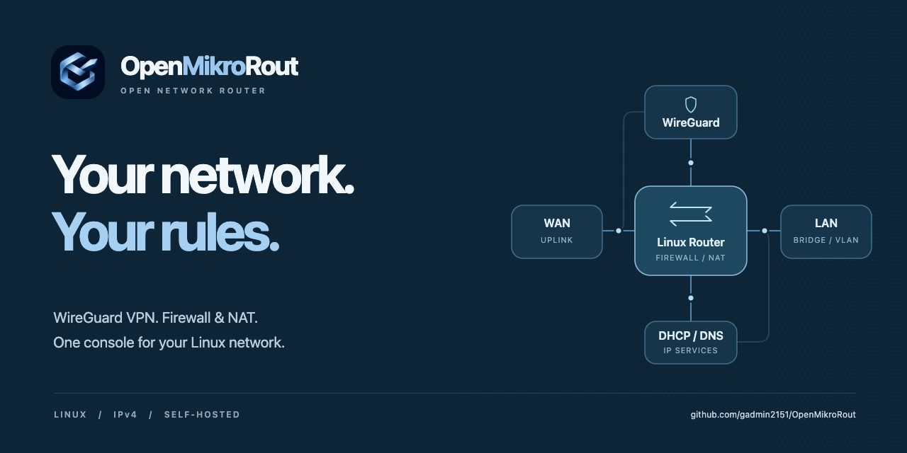
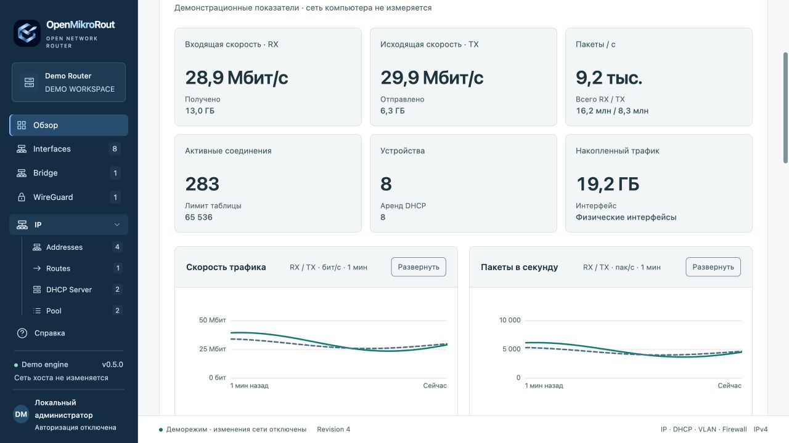
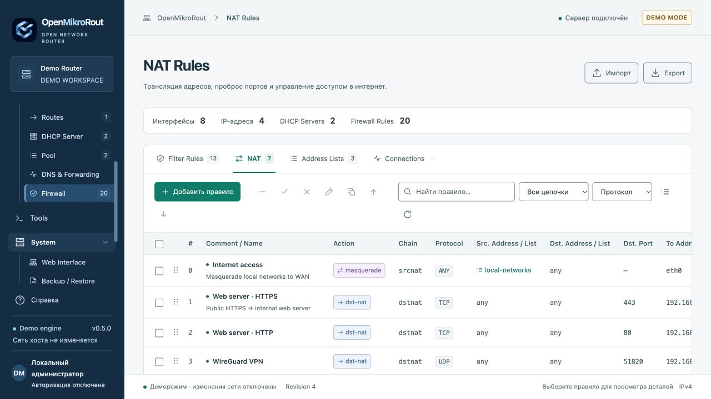
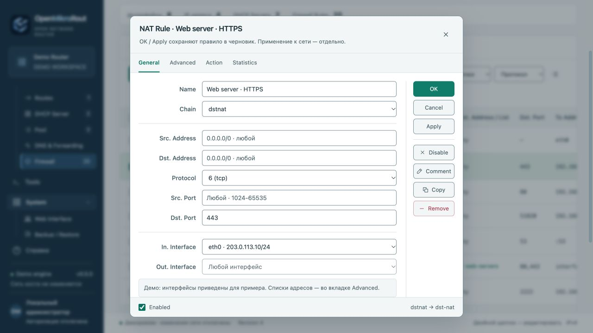
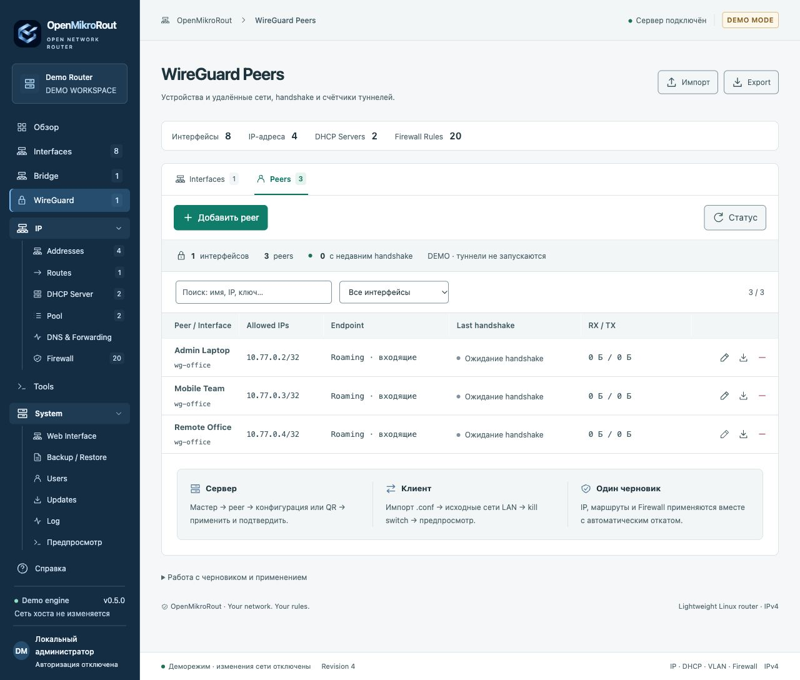
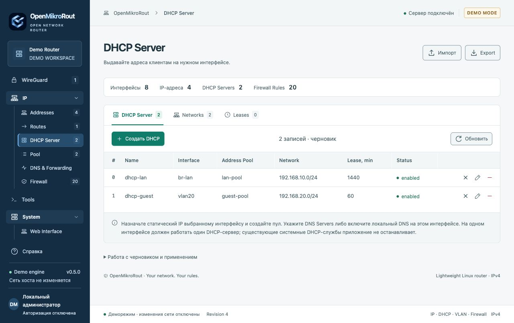
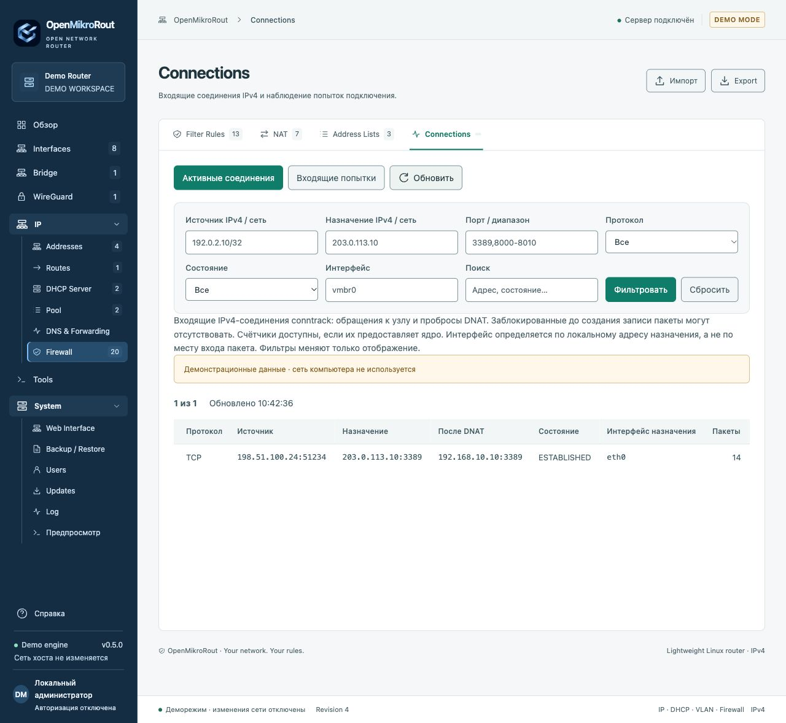
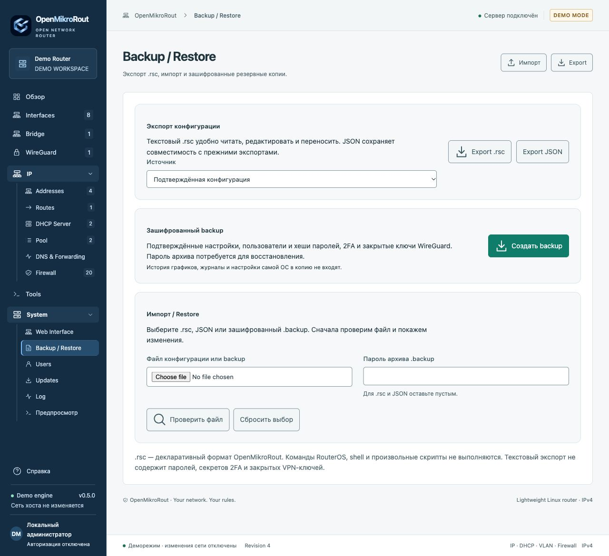

<h1 align="center">
  
</h1>

<p align="center">
  <a href="https://github.com/gadmin2151/OpenMikroRout/releases/latest"></a>
  <a href="https://github.com/gadmin2151/OpenMikroRout/actions/workflows/ci.yml"></a>
  
  
  
</p>

<p align="center"><b>Русский</b> · <a href="README.en.md">English</a></p>

<p align="center">
  <a href="#возможности">Возможности</a> ·
  <a href="#интерфейс">Скриншоты</a> ·
  <a href="#быстрый-запуск">Запустить демо</a> ·
  <a href="#документация">Документация</a> ·
  <a href="https://github.com/gadmin2151/OpenMikroRout/releases">Релизы</a>
</p>

**OpenMikroRout — лёгкая веб-консоль для управления IPv4-сетью Linux.**
WireGuard, Firewall, NAT, маршруты, VLAN, DHCP и DNS собраны в одном рабочем пространстве
с привычной логикой WinBox: таблицы, вкладки, редакторы свойств и перетаскивание правил.

В NAT и Firewall поддерживается отрицание условий кнопкой **!**: например,
«все источники, кроме указанного IP или списка». [Примеры и ограничения](docs/MATCH-NEGATION.md).

Кнопка **!** также есть в фильтрах Connections и остальных списков, а также
в фильтрах Packet Sniffer. [Фильтрация с исключениями](docs/DISPLAY-FILTERS.md).

Визуальный конструктор объединяет условия через **AND / OR**, поддерживает
группы и операторы для IPv4, портов, текста и счётчиков. [Составные фильтры](docs/QUERY-BUILDER.md).

Проект предназначен для администрирования Linux-шлюзов, офисных сетей и лабораторий.
Вы управляете конфигурацией на своём сервере; сетевые операции выполняются локально
стандартными инструментами Linux. Облачный аккаунт для работы не нужен.

<p align="center">
  <a href="docs/images/overview.jpg"></a>
  <br><sub>Обзор сети: трафик, пакеты, устройства и соединения. Все скриншоты сняты в деморежиме; показатели демонстрационные.</sub>
</p>

## Возможности

| Направление                  | Что доступно                                                                                                                                           |
| ---------------------------- | ------------------------------------------------------------------------------------------------------------------------------------------------------ |
| **Security** | Fail2ban с временными списками; Src./Dst. Country и вкладка Fail2ban прямо в редакторах NAT/Filter. Общие профили и GeoIP-база — в Security; сбор блокировок по умолчанию выключен |
| **Hosts & Scan** | ARP/DHCP/LLDP/CDP/MNDP, Network/Port Scan через выбранный интерфейс к локальным и удалённым IPv4-целям, живой прогресс и частичные результаты |
| **Network Tools** | Непрерывный Ping до остановки, traceroute, DNS/TCP-проверки и Packet Sniffer с фильтрами TCP/UDP/ICMP, адресов и порта |
| **WireGuard VPN**            | Сервер, клиент и site-to-site; мастера настройки, импорт `.conf`, peers, Allowed IPs, PSK, клиентские профили и QR-коды                                |
| **Маршрутизация через VPN**  | Выбор исходных LAN-сетей, отдельные таблицы маршрутизации, kill switch, состояние peers и повторное разрешение DNS endpoint                            |
| **Firewall и NAT**           | `input` / `forward` / `output`, `srcnat` / `dstnat`, masquerade, проброс портов, списки адресов и интерфейсов, протоколы, порты и состояния соединений |
| **Интерфейсы и сети**        | Автоопределение портов, bridge и его участники, VLAN 802.1Q, виртуальные `dummy`-интерфейсы, IPv4-адреса и статические маршруты                        |
| **DHCP и DNS**               | Пулы адресов, DHCP-серверы на интерфейсах, резервирования MAC/IP, leases, DNS forwarder и статические A-записи                                         |
| **Мониторинг и диагностика** | RX/TX и счётчики каждые 0,2 с; графики с историей в SQLite; устройства, топ назначений, входящие соединения, ping, traceroute, DNS и TCP-проверки      |
| **Доступ и обслуживание**    | Роли `read` / `full`, личная TOTP 2FA, журнал, подписанные обновления из GitHub, экспорт `.rsc` / JSON и зашифрованный Backup / Restore                |

## Интерфейс

Матовая синяя навигация, светлое рабочее пространство и плотные таблицы.
Скриншоты открываются в полном размере по нажатию.

<table>
  <tr>
    <td width="50%" valign="top">
      <a href="docs/images/nat.jpg"></a>
      <br><b>Firewall / NAT</b><br>Упорядоченные правила, поиск, фильтры и drag-and-drop.
    </td>
    <td width="50%" valign="top">
      <a href="docs/images/rule-editor.jpg"></a>
      <br><b>Редактор правил</b><br>General, Advanced, Action и Statistics в знакомом окне свойств.
    </td>
  </tr>
  <tr>
    <td width="50%" valign="top">
      <a href="docs/images/wireguard.jpg"></a>
      <br><b>WireGuard</b><br>Peers, разрешённые сети, endpoint, handshake и счётчики туннелей.
    </td>
    <td width="50%" valign="top">
      <a href="docs/images/dhcp.jpg"></a>
      <br><b>DHCP и сегментация</b><br>Серверы на bridge и VLAN, пулы, сети и аренды адресов.
    </td>
  </tr>
  <tr>
    <td width="50%" valign="top">
      <a href="docs/images/connections.jpg"></a>
      <br><b>Мониторинг соединений</b><br>Активные подключения и входящие попытки с фильтрацией.
    </td>
    <td width="50%" valign="top">
      <a href="docs/images/backup-restore.jpg"></a>
      <br><b>Backup / Restore</b><br>Перенос настроек, пользователей, 2FA и закрытых ключей WireGuard.
    </td>
  </tr>
</table>

## Изменения с контролем применения

Один общий черновик объединяет интерфейсы, адреса, DHCP, маршруты, VPN и Firewall.

1. **Подготовьте настройки.** Сохранение в редакторе меняет черновик.
2. **Проверьте предпросмотр.** Система проверяет конфигурацию и показывает сетевые операции.
3. **Примените изменения.** До выполнения сохраняется состояние для восстановления.
4. **Подтвердите связь за 60 секунд.** Без подтверждения запускается откат.

Незавершённое применение восстанавливается после перезапуска сервиса.
Работа с чужими интерфейсами и правилами ограничена явными
[границами владения](docs/ADMINISTRATION.md#границы-владения).

## Быстрый запуск

Для демо нужны **Git и Python 3.11+** с модулем `venv`. Подходят Linux и macOS.

```sh
git clone https://github.com/gadmin2151/OpenMikroRout.git
cd OpenMikroRout
./run.sh
```

Откройте **[http://127.0.0.1:8088](http://127.0.0.1:8088)**.
При первом запуске скрипт создаст `.venv` и установит закреплённые зависимости.
По умолчанию используется деморежим с отдельной базой: сетевые настройки компьютера
не изменяются. Node.js для запуска приложения не нужен.

### Рабочая установка

Для управления сетью нужен **Linux** и соответствующие сетевые привилегии.
Предусмотрены native-сервис systemd и Docker Compose с сетью хоста.
В рабочем режиме вход обязателен; логин и пароль администратора задаются при первоначальной установке.

- [Установка Linux и systemd](docs/ADMINISTRATION.md#установка-на-linux)
- [Docker Compose](docs/ADMINISTRATION.md#docker-compose--только-linux)
- [Переменные окружения и первый доступ](docs/ADMINISTRATION.md#переменные-окружения)
- [Подписанные обновления через веб-интерфейс](docs/ADMINISTRATION.md#обновления-из-github)

## Доступ и сохранность конфигурации

- **`read`** — просмотр состояния, графиков, журналов, предпросмотр и текстовый экспорт.
  **`full`** — управление настройками, пользователями и обслуживанием. Права проверяются сервером.
- **TOTP 2FA** включается отдельно для каждого пользователя; по умолчанию отключена.
  Поддерживаются одноразовые резервные коды.
- **Зашифрованный backup** защищён отдельным паролем и включает подтверждённые настройки,
  пользователей, активные 2FA и ключи WireGuard. При восстановлении можно сохранить текущих пользователей.
- **Обновления** принимают подписанный манифест Ed25519 и проверяют SHA-256 архива.
  Native-обновление сохраняет предыдущие код и данные для отката.

## Техническая основа

| Уровень         | Реализация                                                               |
| --------------- | ------------------------------------------------------------------------ |
| Веб-интерфейс   | Локальные HTML, CSS и JavaScript; без сборки и CDN во время работы       |
| API и валидация | Python 3.11+, FastAPI, Pydantic                                          |
| Данные          | SQLite: конфигурация, пользователи, recovery state и история мониторинга |
| Сеть            | iproute2, iptables, wireguard-tools, отдельные экземпляры dnsmasq        |
| Развёртывание   | Linux / systemd или Docker Compose; один процесс приложения на хост      |

### Границы текущего выпуска

Поддерживаются **IPv4 и WireGuard**. IPv6, другие VPN, PPPoE, WAN DHCP client,
динамическая маршрутизация, QoS/queues и управление Wi-Fi пока не реализованы.
VLAN поддерживает создание интерфейсов 802.1Q; bridge PVID/tagged/untagged filtering
пока отсутствует. Текстовый `.rsc` использует формат OpenMikroRout;
импорт скриптов RouterOS напрямую не поддерживается.

Backup приложения не включает ОС/PVE, неуправляемые ресурсы, историю мониторинга
и динамические leases. Полные ограничения и особенности совместной работы
с другими сетевыми менеджерами описаны в [руководстве](docs/ADMINISTRATION.md#текущие-ограничения).

Новые защитные модули требуют однократной установки системных зависимостей на native Linux. [Настройка Fail2ban, GeoIP и discovery](docs/SECURITY-DISCOVERY.md).

## Документация

| Материал                                                        | Содержание                                                             |
| --------------------------------------------------------------- | ---------------------------------------------------------------------- |
| [Руководство администратора](docs/ADMINISTRATION.md)            | Установка, systemd, Docker, окружение, доступ, применение, откат и API |
| [Security & Discovery](docs/SECURITY-DISCOVERY.md) | Fail2ban, GeoIP, системные списки, hosts, сканирование и установка |
| [WireGuard](docs/WIREGUARD.md)                                  | Сервер, клиент, peers, source routing и kill switch                    |
| [DNS и сетевые инструменты](docs/NETWORK-TOOLS.md)              | DNS forwarder, статические записи и диагностика                        |
| [Export / Import / Backup / Restore](docs/CONFIGURATION.md)     | Форматы, шифрование, перенос пользователей и восстановление            |
| [Фирменный стиль](BRAND.md)                                     | Логотип, палитра и правила оформления                                  |
| [Выпуски](https://github.com/gadmin2151/OpenMikroRout/releases) | Подписанные пакеты обновления и изменения версий                       |

## Разработка и проверка

```sh
.venv/bin/python -m pip install -r requirements-dev.lock
.venv/bin/ruff format --check app tests scripts
.venv/bin/ruff check app tests scripts
.venv/bin/mypy app tests scripts
.venv/bin/pytest -q
pnpm install --frozen-lockfile
pnpm check
```

[GitHub Actions](https://github.com/gadmin2151/OpenMikroRout/actions/workflows/ci.yml)
проверяет Python и UI, выполняет изолированные сетевые тесты Linux, собирает контейнер
и проверяет его демозапуск. Сетевые тесты включают WireGuard handshake, передачу IPv4,
kill switch, DNS и восстановление конфигурации. Node.js / pnpm используются для разработки UI.

<p align="center"><sub>OpenMikroRout · Your network. Your rules.<br>Интерфейс вдохновлён WinBox. Управление сетью выполняется средствами Linux.</sub></p>
