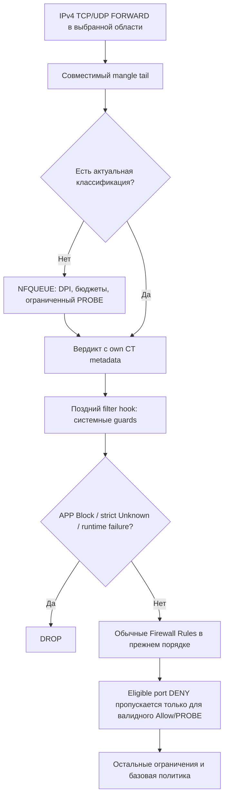

# Applications: план прикладной фильтрации OpenMikroRout

**Дата:** 8 ноября 2026, Europe/Chisinau.

**Статус:** реализован MVP 0.11.0; по умолчанию выключен.

**Исходная версия кода:** `68c624fe02ec6359ef4ff2d0f4077d38e7ebad7a` / 0.10.0.

Реализованы отдельный экран Applications, правила, подписанный каталог,
мониторинг, native nDPI 6.0 companion и обязательное принятие его условий.
Практическое покрытие и ограничения приведены в [APPLICATIONS.md](APPLICATIONS.md).
Разделы ниже сохраняют архитектурный план: наличие пункта плана не означает
проверку всех зашифрованных вариантов трафика или автоматическое включение Enforce.
**Границы этой работы:** исследование, формальная семантика, план интеграции и проверки.
Рабочая конфигурация, службы и правила PVE не меняются.

## 1. Что получит пользователь

Отдельный верхний пункт **Applications / Приложения**, расположенный после
WireGuard, с вкладками **Rules / Catalog / Connections / Settings & Updates**.
Стиль — компактные таблицы и редакторы WinBox, тёмно-синее меню, светлая рабочая
область. Новые плавающие окна и дубли меню не вводятся.

- Выбор приложения по имени: Telegram, YouTube, WhatsApp, Discord и другие.
- Правила Allow / Block для отдельных клиентов, сетей, address lists и интерфейсов.
- Несколько приложений в одном правиле, исключения и понятный порядок правил.
- Разрешённое приложение может перекрыть обычный запрет порта в явно определённой
  области; оно не отменяет остальные ограничения сети.
- Отдельный список прикладных соединений с состоянием, причиной решения и счётчиками.
- Локальный каталог с проверяемыми обновлениями из поддерживаемых источников.
- Сохранение через общий draft → preview → apply → confirm / rollback.

Под «connectivity» покрываются оба полезных сценария: выбор **connection states**
в правиле и отдельный живой монитор **Connections** для приложений.

## 2. Принятые границы первой версии

1. Только **IPv4, TCP/UDP, FORWARD**, для явно выбранных маршрутизируемых LAN/VLAN
   и внутренних сетей VPN. INPUT/OUTPUT самого роутера/PVE не включаются.
2. Работа на уровне сетевого потока/сервиса, не достоверное определение имени
   `chrome.exe` на чужом компьютере. Для идентификации процесса нужен endpoint-agent.
3. Реальный классификатор потоков обязателен. DNS/IP-эвристика — дополнительное
   свидетельство с отдельной маркировкой, а не замена DPI.
4. Никакой TLS-подмены сертификатов, расшифровки HTTPS и установки клиентских CA.
5. Трафик внутри стороннего шифрованного VPN обычно недоступен прикладному анализу.
   Собственный WireGuard можно анализировать после расшифровки, на внутреннем интерфейсе.
6. Мостовой трафик поддерживается только после проверки фактического прохождения
   нужных Netfilter hooks. Глобальные bridge/PVE sysctl автоматически не изменяются.
7. Функция по умолчанию выключена; первое включение — Observe. Observe использует
   ограниченный пассивный источник, без NFQUEUE и изменения разрешений Firewall.
8. Обнаружение, каталог и enforcement имеют отдельные статусы. Наличие приложения
   в каталоге не означает, что для него уже проверена надёжная блокировка или Allow.

## 3. Приоритеты: точный контракт

### 3.1. Основное правило

**Application Allow выше обычного port-DENY, но не является безусловным ACCEPT.**
Это исключение из выбранных запретов портов, после которого продолжается обычная
проверка Firewall. Так сохраняются адресные ограничения и более поздние защитные
правила. Без этого условия ранний `ACCEPT` приложения обходил бы последующие запреты.

Системные ограничения WireGuard, Fail2ban и управления остаются неперекрываемыми.
Правила чужого Firewall/PVE не переписываются и не объявляются переопределяемыми.

### 3.2. Связь с существующими port-DENY

У FilterRule появляется явный признак `application_override_eligible`, default false.
Он допустим только для проверяемых TCP/UDP DROP/REJECT с положительным условием
порта; универсальный DROP, отрицательные/неоднозначные port-условия, INPUT/OUTPUT,
INVALID/UNTRACKED и защитные правила не становятся исключениями автоматически.

При первом включении мастер показывает найденные обычные port-DENY и предлагает
включить для них «Applications имеют приоритет». Выбор создаёт общий черновик,
с видимым diff и обычным подтверждением применения. Отдельные профили на тот же
порт создавать не требуется. Новые port-DENY при включённой функции получают это
предложение в редакторе; защитный запрет всегда можно оставить неперекрываемым.

Компилятор добавляет к такому DENY условие «нет действующего APP_ALLOW или
разрешённого ограниченного PROBE». Он **пропускает только этот DENY**, не выдаёт
глобальный ACCEPT и не переставляет существующие пользовательские правила.

### 3.3. Порядок решений

1. Существующие системные guards: WG confinement, F2B и ограничения управления.
2. Scoped application guard: известный APP_BLOCK, строгий Unknown/failure guard.
   Этот этап стоит до `ESTABLISHED ACCEPT` и чужих ACCEPT в охваченной области.
3. Обычные Filter Rules в прежнем порядке. Только согласованные port-DENY получают
   исключение для действующего APP_ALLOW / PROBE.
4. Остальные правила и базовая политика Firewall без изменения их смысла.

Условия нескольких application rules разрешаются **первым совпадением** в порядке
таблицы. Allow может стоять перед Block для конкретного клиента; скрытого приоритета
«самое специфичное правило» нет. Семейство и дочернее приложение также подчиняются
этому порядку. Drag-and-drop меняет его только после Apply.

| Приложение / состояние                     | Обычный Firewall                                     | Эффективный результат                           |
| ------------------------------------------ | ---------------------------------------------------- | ----------------------------------------------- |
| Нет совпавшего application rule            | Port DENY                                            | Обычный DENY                                    |
| Проверенный APP_ALLOW                      | Eligible port DENY, затем разрешающий путь           | Port DENY пропущен; соединение разрешено        |
| Проверенный APP_ALLOW                      | Неперекрываемый DENY / достигнутый IP или GeoIP DENY | DENY сохраняется                                |
| Проверенный APP_ALLOW                      | После исключения базовая политика остаётся DROP      | DROP; приложения не создают маршрут/доступ сами |
| APP_BLOCK                                  | Port ALLOW / ESTABLISHED ACCEPT                      | APP_BLOCK                                       |
| Pending + подходящий Allow-кандидат        | Eligible port DENY                                   | Только явно разрешённый bounded PROBE           |
| Unknown / истёк PROBE / слабое определение | Port DENY                                            | Без исключения; обычный DENY                    |
| Runtime отсутствует                        | Enforce, default failure policy                      | Scoped DROP в управляемых сетях                 |
| Observe                                    | Любой                                                | Только наблюдение; Firewall без изменений       |

Для первого рабочего примера: обычные IP-ограничения → DENY TCP/443 с eligible →
обычное разрешение LAN→WAN. Allow выбранного приложения пропускает DENY/443;
блокировка другого приложения действует даже при обычном разрешении TCP/443.

## 4. Почему нужен этап Pending / PROBE

TCP SYN не содержит достаточной информации о большинстве приложений. До TLS
ClientHello необходимо пропустить SYN/SYN-ACK/ACK. Некоторые протоколы требуют
ещё нескольких пакетов. Если сразу отбросить SYN из-за порта, DPI не распознает
приложение и разрешение приложения никогда не сработает.

Поэтому требование «разрешить приложение поверх закрытого порта» реализуемо только
с ограниченным пробным пропуском либо заранее доступным достаточным свидетельством.
**Гарантировать ноль переданных байтов неизвестного приложения при этом нельзя.**
UDP и TCP Fast Open могут содержать полезные данные уже в первом пакете.

PROBE разрешается лишь для подходящего scope/Allow-кандидата, при исправном runtime,
после явного worker verdict. Действует на оба направления одного потока, не создаёт
постоянного IP-исключения. Все не относящиеся к портам ограничения продолжают работать.

Начальные **лабораторные**, не обещанные производственные лимиты:

| Ограничение                       | Начальное значение для PoC                |
| --------------------------------- | ----------------------------------------- |
| Время определения                 | 2 секунды от первого пакета               |
| Пакеты / wire bytes               | 32 пакета / 64 KiB суммарно в обе стороны |
| Pending на клиента / глобально    | 32 / 512                                  |
| Новый PROBE на клиента            | 20/s, burst 40, плюс глобальный лимит     |
| Очередь / deadline verdict        | 256 пакетов / до 250 ms                   |
| DPI worker / supervisor MemoryMax | 256 MiB / 128 MiB                         |

Считаются реальные пакеты, включая retransmissions, а не только уникальный payload.
Нужны ограничения и по пакету/потоку, и по клиенту: иначе запрет обходится созданием
множества коротких Pending-соединений. Исчерпание любого лимита прекращает исключение.
Недостаточное покрытие при этих лимитах отражается как Unsupported/Unknown, а не Allow.

Для Block-only правил политика Unknown выбирается явно: обычный Firewall либо
строгий DROP в scope. Строгий режим также имеет конечные бюджеты; интерфейс не должен
выдавать разрешённую фазу определения за полностью заблокированные первые пакеты.
Default для корректного Unknown — обычный Firewall, без port-exception. Это отличается
от default строгой failure policy при неисправном datapath, см. раздел 7.5.

## 5. Движок и лицензия: обязательный первый gate

Кандидат для классификации — **nDPI**, через сменный adapter с фиксированной ABI.
Это библиотека анализа, а не готовая интеграция blocking. Актуальная 6.0 требует
отдельного внимания: core LGPLv3+, а DNS/TLS/QUIC-компоненты имеют dual-license.
Заявленные разработчиком условия коммерческого и косвенно коммерческого применения
отличаются. Предыдущая общая формулировка «весь nDPI свободно включаем» недостаточна.
Основание: [объявление ntop][s1] и [README.license.md в 6.0][s2].

До выбора production-комплектования:

- Зафиксировать допустимый профиль компонентов и условия распространения бинарников.
- Определить лицензию самого OpenMikroRout: в текущем checkout корневого LICENSE нет.
- Для нужных dual-license компонентов подтвердить право использования либо выбрать
  другую сопровождаемую реализацию. Платные компоненты не загружать автоматически.
- Старый nDPI не выбирать молча ради обхода лицензии: нужен отдельный анализ
  безопасности и сопровождения; устаревший движок не становится production-решением.
- Не объявлять полный каталог поддержанным, если необходимый dissector не установлен
  или не входит в разрешённый профиль. UI показывает такую запись как недоступную.

Это **Go/No-Go gate**, а не скрытая зависимость или обещание бесплатного полного DPI.
Архитектура независима от конкретного provider; engine update поставляется только
через проверенный подписанный пакет OpenMikroRout, отдельно от обновления данных.

## 6. Исследованный каталог и интернет-источники

Сохранены два машиночитаемых артефакта:

- [Полный инвентарь источников на 08.11.2026](research/application-source-inventory-2026-11-08.json):
  имена и native IDs nDPI 6.0, имена всех файлов `data/` V2Fly, точные commit/hash.
- [Начальное сопоставление приложений](research/application-catalog-seed.json):
  15 семейств, 22 дочерних определения, собственные OMR IDs, RU/EN, категории,
  проверенные engine/provider mappings. Все enforcement-capabilities пока false.

В nDPI найдено **490** явно перечисленных ненулевых не-FREE protocol IDs;
в V2Fly — **1555** файлов списков. Это **не 2045 готовых распознаваемых приложения**:
там смешаны протоколы, приложения, компании, категории и маршрутизационные списки.
В инвентаре нет исполняемого кода, payload-сигнатур или полного набора доменных правил.

| Источник                          | Назначение                                            | Решение                                                                                |
| --------------------------------- | ----------------------------------------------------- | -------------------------------------------------------------------------------------- |
| [nDPI 6.0][s3]                    | Имена, native IDs, категории, движок, hints           | Версионный adapter; license gate; не обновлять код как feed                            |
| [V2Fly domain-list-community][s4] | Списки доменов сервисов/компаний/категорий            | MIT с notice; дополнение к DPI; нормализовать через OMR publisher                      |
| [Microsoft 365 endpoints][s5]     | Официальные URL/IP service areas, version/changes API | Optional vendor provider; проверить условия перепубликации; не считать всё Teams       |
| [Telegram CIDR][s6]               | Официальные сети сервиса                              | Дополнительное свидетельство; проверить условия feed, не обещать полное покрытие       |
| [OpenAppFilter][s7]               | Пример каталога и app signatures                      | OpenWrt-специфика; неоднозначные коммерческие условия; не ставить kernel module на PVE |
| [Netify][s8]                      | Альтернативный поддерживаемый provider                | Полный набор/частые обновления могут требовать лицензии; не scrape публичный каталог   |

Подтверждённый снимок V2Fly: release `20261108011013`, commit
`e8d7a10a15bf662c927a40a3aa680bae86379608`. Использовать immutable refs, не `latest`
без pin. У upstream есть checksums, но отдельная доверенная detached signature
в просмотренном build workflow не найдена. SHA256 не заменяет аутентичность издателя.

Начальные семейства: Telegram, YouTube, WhatsApp, Discord, Teams, TikTok, Steam,
Zoom, Netflix, Signal, Facebook, Instagram, Twitch, Spotify, GitHub. Существование
native ID подтверждает только mapping; фактические chat/calls/files/upload/Kids
сценарии должны отдельно пройти PCAP/интеграционные проверки.

### 6.1. Нормализованный production-каталог

Каждая запись содержит:

- Постоянный `app.id`, `kind` (application/family/provider/category/protocol), aliases,
  RU/EN display names, категорию, явные parent/children и lifecycle/tombstone.
- Version-aware engine mapping: символическое имя + native ID + совместимые версии.
- Источник каждого домена/CIDR/правила, exact commit/version/hash, license/notice,
  дата проверки и описание покрытия.
- Методы определения: DPI / hostname / exclusive IP / shared IP / port guess /
  heuristic. Не сводить разные основания к выдуманному универсальному проценту.
- Раздельные capabilities `observable`, `block_validated`, `allow_over_port_deny`,
  ограничения транспорта/версии и связанные доказательные fixtures.
- Явное описание неоднозначности. SNI/Host можно подставить, shared CDN/IP не
  подтверждает приложение. Эти сигналы сами по себе не повышают права над port-DENY.

DPI — практическая классификация, не криптографическое доказательство программы.
Даже протестированный Allow имеет описанную область доверия; строгие IP/WG/F2B
ограничения остаются. Для неоднозначного HTTPS-сервиса `allow_over_port_deny` может
быть недоступен, хотя наблюдение/блокировка доступны. Это видно до сохранения правила.

При выборе семейства сохраняется **развёрнутый список конкретных дочерних IDs**
текущей версии. Добавление upstream нового приложения не расширяет Allow молча.
Broad provider/category и generic TLS/QUIC/HTTP/DNS/Unknown не используются для
приоритетного Allow в первой версии. Наличие общего TLS не должно открывать весь
HTTPS. Семейства раскрываются в проверенные конкретные app leaf IDs.

### 6.2. Синхронизация

1. CI publisher получает данные только из фиксированных HTTPS sources; проверяет
   version/hash/license и закрепляет immutable commit. Не исполняет upstream код.
2. Offline importer ограничивает размер, вложенность includes, количество правил,
   поля и длины; отбрасывает private/special CIDR. Для V2Fly разрешены domain/full;
   keyword/regexp не передаются в worker. Отбрасывания отражаются в coverage report.
3. Создаёт semantic diff, тестирует mappings/fixtures, сохраняет license notices,
   минимальную версию OMR/engine и совместимость catalog schema.
4. Выпускает отдельный подписанный Ed25519 OMR data bundle. В manifest указываются
   `notice_files`, и copyright/license notices включаются файлами, не только URL.
   Канал данных — отдельный репозиторий/manifest endpoint, не `/releases/latest`
   основного приложения: выпуск каталога не должен сломать текущий GitHub updater.
   Не переиспользовать
   доверие к checksum upstream как подпись OMR; разделить ключи/назначения engine и data.
5. Роутер раз в сутки с jitter проверяет manifest через фиксированный provider;
   ETag, timeouts, bounded retries/backoff. Ключи провайдеров — в vault, не в RSC/логах.
6. Загружает staging, проверяет подпись, archive safety, hash, schema, limits,
   совместимость, tombstones и семантические изменения применённых правил.
7. Автоматически может скачать и подготовить. **Активация**, меняющая enforcement,
   проходит общий preview/apply. Автоматическая активация — отдельная будущая
   политика с явно заданными границами, не default.
8. Атомарно меняет catalog pin/sets/runtime generation; при ошибке сохраняет last
   known good. Сетевое скачивание не держит глобальный firewall lock.

Предварительные пределы importer: manifest 64 KiB, archive 32 MiB, распаковка
128 MiB, глубина includes 8, 2 млн нормализованных записей, без symlink/hardlink,
абсолютных путей и исполняемых файлов. Точные границы подтвердить реальным feed.
Следующий root-key принимается только через доверенное обновление/подписанную ротацию.
Откат к старому catalog serial допустим только как явная локальная rollback-операция.

Синхронизация скачивает общие данные. DNS-запросы, адреса клиентов и flows наружу
для онлайн-классификации не передаются.

## 7. Linux datapath

### 7.1. Разделение процессов

- Python web/API — управление, схема, каталог, монитор. Не обрабатывает каждый пакет.
- Малый queue supervisor — только фиксированный Netlink/IPC контракт, policy checks,
  kernel marks, budgets и watchdog. Привилегии минимальны для NFQUEUE/conntrack.
- DPI worker — отдельный непривилегированный C/C++ процесс с engine C API;
  без CAP_NET_ADMIN, внешних сетевых соединений и доступа к секретам/конфигурации PVE.
  Разрешён только приватный AF_UNIX IPC; память/CPU/FD/PIDs ограничены systemd.

Supervisor не принимает от worker произвольные iptables команды или готовый ACCEPT.
Worker возвращает app ID, основания и состояние; решение вычисляется по активной
политике. Ответ связан с конкретным flow token/policy epoch, проверяется по каталогу.
Сокеты приватные, IPC bounded; stale/повторный ответ не меняет новый поток с тем же tuple.

### 7.2. Где стоит очередь

Основной PoC — принадлежащая OMR цепочка в **mangle FORWARD** перед filter FORWARD,
после DNAT/routing и до SNAT. Она видит реального LAN-клиента; original/reply tuple,
conntrack zone/id сохраняются отдельно. Оба направления Pending идут одному worker.

`NF_ACCEPT` после NFQUEUE не означает «перейти к следующей iptables-строке этой цепочки»:
он завершает текущий путь hook/chain и продолжает последующие hooks. Поэтому:

- Очередь не ставится в filter перед ordinary DENY: иначе их можно обойти.
- После QUEUE не размещается обязательный MARK/guard в том же mangle hook.
- Чужие MARK/DSCP/QoS-преобразования должны выполниться до queue tail.
- Preflight отвергает несовместимые чужие terminal ACCEPT/QUEUE/jumps и гарантирует,
  что выбранный трафик действительно доходит до нашей очереди.
- Если безопасный tail существующего mangle-пути невозможен, включение блокируется.
  Отдельный owned nft hook между mangle/filter — отдельный последующий adapter/PoC,
  а не незаметное переключение всего PVE на другой backend.

Семантика подтверждена [libnetfilter_queue verdict docs][s9] и [Netfilter hooks][s10].
Одна очередь сначала предпочтительнее преждевременного multiqueue; дальнейшее
шардирование — только с сохранением порядка обоих направлений одного flow.

### 7.3. Метаданные без повреждения WireGuard marks

Предпочтительный механизм — nested `NFQA_CT` в **одном** queue verdict с
`CTA_MARK` и `CTA_MARK_MASK`; `skb->mark` не изменяется. В Linux 6.8 обработчик
обращается к conntrack, прикреплённому к queued skb, до reinjection. Это позволяет
не искать ещё не подтверждённый первый SYN через отдельный ctnetlink UPDATE.
Основание: [nfnetlink_queue.c][s11] и [nf_conntrack_netlink.c][s12].
Кодирование строго: `CTA_MARK = desired_owned_bits & ownedMask`,
`CTA_MARK_MASK = ownedMask`. Полный старый mark в payload не передаётся: kernel
использует RMW/XOR, и одна маска не защитит чужие биты при неверном значении.

Это source-level обоснование, не проверка конкретного ядра PVE. До включения нужен
PoC первого SYN: наша CT-метка видна следующему filter hook ещё до POSTROUTING confirm;
чужие CT-биты и WireGuard skb mark `0x4F4D0000 | ...` сохранены.

Обработка NFQA_CT может не записать mark при отсутствующем hook/атрибуте, сохранив
общий NF_ACCEPT. Поэтому **ACK недостаточно**: filter разрешает исключение только
при реально присутствующих, валидных owned CT-state и текущем epoch. Отсутствие
метки не превращается в Allow. Произвольные payload/expectation/helper/status/timeout
атрибуты из userspace verdict не используются.

Scope, квоты, app guards и port-exceptions привязываются к **original направлению
conntrack**: netns, zone, flow ID/время рождения, original source/destination,
DNAT-контекст и исходные ingress/egress. Они действуют на оба направления этой
связи, а не проверяют только текущий `-s LAN` у каждого пакета. Ответ WAN→LAN не
должен потерять scope или получить scope другой LAN. Первое поступившее наблюдение
уже established flow может быть reply; направление не угадывается по этому пакету.
В первой версии scope означает LAN/VPN-инициированное соединение, а не любую
WAN-инициированную DNAT-сессию к серверу в этой LAN.
Preflight должен уметь построить безопасный scoped guard даже при отсутствующей
app-метке. Неоднозначные overlapping CIDR без разделения zone/netns и необходимого
NAT/интерфейсного контекста отвергаются, а не расширяют guard на соседние сети.

Маска CT bits и queue IDs выделяются только после preflight существующих потребителей.
Маска сохраняет остальные биты, но kernel RMW не гарантирует отсутствие гонки с
чужим конкурентным writer. Несогласованный connmark writer — причина отказа включения.
Правила приложения не копируют CT mark в skb и не затрагивают policy routing.

Mark хранит состояние/решение/ограниченный epoch, не native app number. Полный
policy/catalog generation и stable app ID находятся в runtime. Перед повторным
использованием epoch необходим барьер: scoped quarantine → остановка нового queue
admission → drain/drop старых queued packets и отмена старых worker replies →
очистка только собственных CT bits/cache → активация нового epoch → снятие guard.
Старый in-flight verdict не должен заново записать старый Allow после очистки.
Оборачивание тега без этого барьера запрещено. `conntrack -F`, очистка чужих marks
и глобальных таблиц запрещены.

### 7.4. Состояния и обновление активных flows

`Pending → Detected / Unknown / Unsupported`, отдельно `Allow / Block / Fallback`
и наблюдаемое решение OMR Firewall. INVALID/UNTRACKED не получают APP_ALLOW/PROBE.
RELATED не наследует разрешение приложения без проверяемой связи с master flow.

Кешируется **классификация**, не безусловный Allow/Block до конца flow. Connection
state может измениться без смены policy generation. Supervisor рассчитывает
first-match outcome для каждого поддерживаемого conntrack state; kernel fast path
выбирает outcome по **текущему** state у каждого пакета. Компактный state-indexed
outcome profile и epoch входят в выделенные CT bits. NEW-only Block не остаётся
автоматически Block после перехода в ESTABLISHED, а ESTABLISHED-правило не пропускается
из-за закешированного NEW outcome. Этот профиль также проверяется на обоих направлениях.
Изменение source lists/scopes/маршрутизации, влияющее на outcome, инвалидирует generation.

Валидация v1 детерминирована: Allow должен покрывать NEW и ESTABLISHED либо все
поддерживаемые состояния. NEW-only / ESTABLISHED-only Allow отклоняется, чтобы не
создать невозможное начальное соединение. NEW-only Block для приложения, требующего
позднего распознавания, также отклоняется. Первый-packet-capable UDP допускает такой
Block только при подтверждённой соответствующей catalog capability.

После Detected состояние входит в bounded cache; быстрый путь не копирует весь
трафик в userspace. При изменении правил/catalog/runtime generation старый Allow
нельзя доверять. На время переоценки исключение от port-DENY снимается; известный
Block не исчезает до применения нового явного решения. Блокировки действуют до
ESTABLISHED ACCEPT. Новые соединения классифицируются заново; QUIC migration не
получает чужое разрешение только по совпадению connection ID.

Новый Block применяется к подходящим уже известным flows без глобального CT flush.
Для ранее не наблюдавшихся established flows classification может оказаться Unknown;
UI показывает это, а strict policy определяет результат. Принудительно завершать
чужие TCP-сессии или отправлять spoofed RST без отдельного действия не требуется.

### 7.5. Отказ и откат

`--queue-bypass` и `NFQA_CFG_F_FAIL_OPEN` не используются. Overflow/отсутствие
consumer не должны превращаться в неконтролируемый ACCEPT. Unresponsive worker
получает bounded verdict timeout; накопление пакетов/памяти ограничено.

В Enforce отсутствие корректной/current CT metadata (включая ошибку NFQA_CT parse)
— **datapath failure, не обычный Unknown**. При default строгой failure policy такой
пакет попадает в scoped DROP/HOLD **перед** ordinary/ESTABLISHED/foreign ACCEPT,
независимо от выбора поведения для корректно классифицированного Unknown.
Недостаточно лишь не дать ему port-exception: baseline может разрешать его.
Эта проверка покрывает unmarked, stale и некорректные метки и проверяется отдельно.

Default Enforce failure policy — **block managed scope**, с исключённым control plane.
Режим обычного Firewall при отказе возможен как явно выбранное ослабление политики;
панель показывает, что полная блокировка приложений в нём не гарантируется.

При отказе: сначала снять PROBE/Allow exemptions и установить scoped fallback,
сохранить известные Block, затем убирать queue hooks. Обратный порядок допускает
обход через ESTABLISHED ACCEPT. Независимый watchdog/ExecStopPost и startup guard
проверяются отдельно от web-процесса. Нулевое окно обнаружения отказа не обещается;
допустимый измеренный интервал watchdog включается в отчёт PoC.

## 8. UI и редактор

**Rules:** компактный WinBox toolbar `+ / − / enable / disable / copy / comment /
move`, DnD + клавиатура, номер/приоритет, source, приложения, action, counters,
статус и причина недоступности. Изменения порядка входят в общий draft.

Редактор General / Applications / Advanced / Action:

- Имя, enabled, comment; source subnet/list, input interface/list; destination
  subnet/list и выбранный routed egress. Несколько app IDs = OR, поля scope = AND.
  Клиент и интерфейсы относятся к original/инициирующему направлению; reply-пакеты
  наследуют тот же scope, а не повторно проверяются как новый источник из WAN.
- Поиск каталога и обычные checkbox, сохранение выделения между страницами.
  «Выбрать все» относится к видимой странице. Не рендерить тысячи checkbox сразу.
- Выбор семейства раскрывает закреплённые дочерние IDs. Недоступные/непроверенные
  capabilities видны до Apply; неизвестный ID никогда не означает «любое приложение».
- Connection states как в Firewall, default все поддерживаемые. Недостижимые
  комбинации отклоняются по строгим правилам раздела 7.4 с объяснением причины;
  реальное ESTABLISHED не переименовывается в NEW ради интерфейса.
- Allow / Block, bounded logging, эффективный приоритет и список затронутых port-DENY.

**Catalog:** имя, тип, категория, families/features, метод, engine/license status,
версия/источник/покрытие, Observe/Block/Allow capability. Только расширенный builder.

**Settings & Updates:** scopes, Observe/Enforce, budgets, Unknown/failure policy,
runtime/preflight/queue health, выбранный engine profile, active/staged catalog,
check/download/diff/activate/rollback. Синхронизация и активация различаются явно.

RU/EN используют действующий профиль пользователя. Обычный read видит каталог,
монитор и фильтры; full изменяет правила, активирует каталог и управляет runtime.
Нужны доступные labels, checkbox с клавиатуры, стабильные колонки и 390px layout.

## 9. Connections для приложений

Нужен **новый источник данных**, а не переименование текущего `app/connections.py`:
сейчас он показывает входящие обращения к хосту/DNAT и входящие попытки, не все
исходящие LAN flows, а интерфейс выводит по локальному адресу.

Application monitor получает runtime events и связывает их с conntrack по netns,
zone, ID, original/reply tuple и времени рождения. Показывает:

- приложение/семейство, source client, original destination и адрес после NAT;
- настоящий ingress/egress из Netfilter metadata, транспорт и conntrack state;
- classification state, метод/основание, app-rule decision, **наблюдаемое решение OMR**,
  имя запрещающего Firewall rule или reason Unknown/budget/failure;
- packets/bytes в обе стороны, скорость, first/last seen, policy/catalog version.

Blocked unconfirmed flows могут отсутствовать в conntrack: для них нужен собственный
bounded журнал решений. Новые поля дополняют обычный Connections ссылкой на приложение,
но существующий смысл и API incoming monitor не меняются.

Allow в нашем обработчике не доказывает фактическую доступность сервиса: следующий
чужой/PVE hook, сеть или сам сервер могут отбросить пакет. Если окончательный вердикт
не наблюдался, показывать Unknown/«решение OMR», а не выдуманный end-to-end Connected.
Conntrack seen-reply/handshake — отдельное наблюдение, не результат входа в приложение.

После классификации пакеты идут fast path, поэтому queue counters **не являются
полными flow counters**. Использовать conntrack accounting; если оно выключено,
показывать недоступность, а не ноль. Изменение host sysctl accounting требует
отдельного явного preview, не выполняется скрыто. Новые настройки не исправляют
счётчики уже существующих соединений задним числом.

Один общий server cache, cursor/пагинация 50/100/250, максимум 500 строк; обновление
видимой страницы примерно раз в секунду с pause скрытой вкладки и отменой запросов.
Только общий advanced builder, сортировка столбцов, никакой второй формы быстрых
фильтров. Не сбрасывать scroll/selection/focus и незавершённый draft фильтра.
Payload, cookies, TLS secrets и полные URLs не сохранять. Агрегаты — SQLite с
лимитом строк/диска и retention; запись каждого пакета в БД не нужна.

## 10. Модель, API и хранение

Явное `Configuration.applications: ApplicationConfiguration`, default disabled.
Строгие Pydantic-модели (`extra=forbid`), bounded lists/strings, UUID rule IDs,
ссылки на стабильные app IDs, settings/scopes/policy и pinned catalog/engine generation.
Правила не хранят mutable upstream display name вместо ID.

SQLite `applications.sqlite3`: schema migrations, версии/manifest/provenance,
catalog entries + aliases/tombstones/mappings/capabilities, source/update jobs,
ограниченные decision events и агрегаты. Indices: `(catalog_id,app_id)`, category/name,
`(time,client)`, flow key и job status. Уникальные source versions/hash и транзакции
исключают повторное применение обновления; query builder использует bound parameters.
Состояние живых потоков — ограниченный memory cache, не browser storage.

Предлагаемые API (контракты уточняются в implementation):

| Доступ    | Endpoint                                            | Назначение                                      |
| --------- | --------------------------------------------------- | ----------------------------------------------- |
| read/full | GET `/api/applications/status`                      | Health, capabilities, active/staged versions    |
| read/full | GET `/api/applications/catalog` и `/{id}`           | Cursor/search/expression, сведения и coverage   |
| read/full | GET `/api/applications/connections`                 | Bounded application flows и effective decisions |
| read/full | GET `/api/applications/events`, `/counters`         | Ограниченная история/агрегаты                   |
| full      | PUT `/api/config`                                   | Общий draft с revision, без второго save/apply  |
| full      | POST `/api/applications/catalog/check`, `/download` | Идемпотентное фоновое задание, только данные    |
| full      | Общий preview/apply/confirm                         | Включение runtime, правила и activation pin     |
| full      | POST `/api/applications/connections/{id}/terminate` | Будущая отдельная proof-protected операция      |

Middleware/auth/full-access/CSRF обязательны на сервере; UI allowlist их дополняет.
`security_dirty` включает Applications и каноническое полное содержимое/порядок
eligible FilterRules: смена порта, source или положения при неизменном флаге тоже
меняет область исключения. Активация
enforcement/catalog проходит действующую password/TOTP proof, а не отдельный обход.
404/409/422 имеют предсказуемые причины; download job не удерживает HTTP до окончания.

## 11. Интеграция в текущие файлы

| Точка                                          | Что необходимо изменить при реализации                                                               |
| ---------------------------------------------- | ---------------------------------------------------------------------------------------------------- |
| `app/models.py`, новые `application_models.py` | Строгий typed config, app refs, eligible flags, schema defaults                                      |
| `app/compiler.py`, `filtering.py`              | Условный пропуск eligible DENY, scoped app guards перед ACCEPT, explain/counters                     |
| Новый `application_datapath.py`/driver         | Owned mangle hooks, inspect/test/snapshot/restore, несовместимые foreign rules                       |
| `app/runtime.py`, `firewall.py`                | Общий prepare/check/snapshot/apply/restore; security_dirty и durable recovery                        |
| `app/system_lists.py`, `ipsets.py`             | Если нужны app hint sets: отдельный тип/ownership, TTL, atomic swap; не обходить geo_/f2b_ whitelist |
| `app/networking.py`                            | Только optional DNS hints/enforcement через собственный dnsmasq; не захватывать DNS всех PVE служб   |
| Новые catalog/monitor/policy services          | Separation of concerns; Python не в packet path                                                      |
| `app/main.py` / новый router API               | Lifespan, permissions, bounded status/jobs/monitor endpoints                                         |
| `app/static/navigation-ui.js`, `app.js`        | Один пункт и четыре views, lifecycle/polling, общий draft bar                                        |
| Новый `applications-ui.js`                     | WinBox таблицы/редактор, paged checkbox, RU/EN, общий query builder                                  |
| `access-ui.js`, `messages*.js`                 | Read actions, full controls, существующий язык профиля                                               |
| `app/rsc.py`, `backups.py`                     | Новые settings/list sections и summary; round-trip и совместимость                                   |
| `app/bootstrap.py`, deploy/systemd             | Startup guard до трафика, capability preflight, runtime/watchdog isolation                           |
| `scripts/build_release.py`, updates/deploy     | ABI/OS/архитектура/подписи companion, согласованный update/rollback                                  |
| Dockerfile / compose / CI                      | Optional native dependencies, isolated network/PCAP tests, default demo без DPI                      |

Native зависимости не устанавливаются неявным `apt upgrade` из веб-панели. Companion
поставляется отдельно как проверенный архитектурный пакет; обычный updater проверяет
его совместимость и не включает функцию при отсутствии нужных компонентов.
Начальная целевая платформа — Linux amd64/PVE; ARM64 и другие backend — отдельные gates.

## 12. Apply, backup, restore и update

1. Prepare: скачать/проверить staging вне глобального lock; pinned generation immutable.
2. Check: engine/license/ABI, kernel features, hooks/masks/queue, scopes, чужие правила,
   budgets; синтаксис iptables/dnsmasq; evidence capability каждой выбранной записи.
3. Snapshot: существующая конфигурация + app catalog/engine pin, собственные mangle/filter
   hooks, runtime generation и необходимые hint sets. Не сохранять packet payload.
4. Apply: временный scoped guard, подготовка runtime/consumer до queue hooks,
   проверка readiness, установка нового поколения, затем снятие временного guard.
5. Confirm: существующие 60 секунд и независимая связь; без confirm — rollback.
6. Rollback: сначала защитить scope, вернуть совместимые rules/catalog/engine,
   инвалидировать собственные stale Allow, восстановить собственные hooks/sets,
   затем снять временную защиту. Учитывать невозможность общей атомарности разных
   таблиц/процессов; recovery journal покрывает каждый промежуточный этап.

RSC получает settings Applications и ordered rules с app IDs/pins; ограничение
размера RSC не обходится встраиванием всей базы. Текущий backup format 1 строго
типизирован, лимиты plaintext/archive — **8 MiB** (`backup_archive.py`). V1 сохраняет
bounded pins/manifest/выбранные определения в согласованных typed config полях,
без новых произвольных top-level полей архива. Полный feed до 32 MiB и engine binary
туда не вкладываются. Restore preflight использует проверенный локальный cache или
получает совместимый подписанный pin; без него enforcement не включается. Полный
offline bundle потребует отдельного format 2 и явной политики размера/совместимости.
Download credentials, ephemeral flows, текущие marks и transient events не экспортируются.

Старый backup/RSC импортируется с Applications disabled. Новый импорт с неизвестным
catalog/engine не включает enforcement молча; prepare получает нужный pin либо
возвращает понятную ошибку. Обратный downgrade на версию без схемы Applications
блокируется до явного отключения/совместимого recovery plan, а не теряет правила.
Миграция существующей установки не применяет конфигурацию: сохраняет revision,
пользовательский draft, pending/recovery и семантику applied. Default disabled
добавляется совместимым способом; raw config/applied сравнения и сериализация
покрываются отдельными update-preservation тестами. Новая DB мигрирует транзакционно.

## 13. Этапы и обязательные Go/No-Go

| Этап                      | Результат                                               | Условие перехода                                          |
| ------------------------- | ------------------------------------------------------- | --------------------------------------------------------- |
| 0. Контракт и лицензии    | Этот план, source inventory, разрешённый engine profile | Нет неясных прав на необходимый код/feed                  |
| 1. Kernel PoC             | Изолированный LAN→router→WAN стенд, metadata и очередь  | Первый SYN, NAT, marks, failure semantics доказаны        |
| 2. Observe                | Реальные flows и отдельный UI без блокировок            | Проверенное покрытие, Unknown, bounded CPU/RAM            |
| 3. Block                  | Правила и guards без port override                      | Block побеждает established/port allow; recovery работает |
| 4. Allow over port-DENY   | Explicit eligible, PROBE, explain                       | Нет обхода IP/WG/F2B, бюджеты и spoof-negative tests      |
| 5. Catalog publisher/sync | Подписанные data bundles, diff и activation             | Invalid feed/update/rollback/лицензия проверены           |
| 6. Release и пилот        | Подписанный пакет, Observe на выбранной сети            | Только после всех gates — Enforce и независимый контроль  |

Базовые каталожные данные и UI не считаются готовым этапом Allow. Если обязательный
gate не пройден, выпуск соответствующей capability блокируется; нельзя подменить
его IP-эвристикой и назвать полноценным распознаванием приложения.

## 14. Матрица испытаний до выпуска

**Policy/unit:** first-match, family snapshots, пересечения source/scope, многократные
port-DENY, поздний IP/GeoIP DENY, default DROP, weak evidence, Unknown, no app match,
NEW/ESTABLISHED state transitions без нового epoch, INVALID/UNTRACKED, stale epoch,
достижение лимитов, повторный ответ worker.
Проверить, что после выключения Applications скомпилированная legacy policy идентична.

**Kernel/netns (без PVE):**

- Первый SYN с unconfirmed CT: nested metadata появляется в filter; отсутствующий
  NFQA_CT/hook не предоставляет исключение, а strict scope DROP/HOLD обгоняет даже
  ранний ordinary/ESTABLISHED/foreign ACCEPT. Чужие CT bits и skb/WG marks сохраняются.
- Port DENY + App Allow с SYN/SYN-ACK/ACK + классификацией; тот же порт для другого
  приложения и spoofed SNI/Host не получает разрешение.
- App Block поверх обычного ACCEPT и ESTABLISHED; ранние/поздние IP/WG/F2B guards.
- Два направления, SNAT/DNAT/hairpin, original/reply, разные zones с одинаковым tuple;
  reply scope не проверяется ошибочно по текущему source LAN.
- Очередь после чужих mangle DSCP/MARK/QoS; несовместимые terminal paths отвергаются.
- Повторы/out-of-order, фрагменты/GSO/truncation/TFO, UDP/QUIC, недоступный dissector,
  HTTP/2/3 multiplexing и неоднозначный общий CDN. Ошибки — Unknown, не тихий Allow.
- Crash/hang supervisor/worker/web, исчезновение queue consumer, переполнение,
  медленный IPC, лимиты памяти/новых потоков; измерение окна watchdog.
- Смена правил/catalog, restart, update, epoch wrap с задержанным старым verdict,
  rollback, power loss между фазами.
  Не уничтожаются чужие правила/CT, control plane доступен.

**Каталог/API:** invalid signature, rollback replay, hash mismatch, ZIP/tar bomb,
traversal/symlink, огромные includes/regex, deleted IDs, license/profile mismatch,
авторасширение категории/семейства, partial download, 304, concurrent jobs, SSRF,
injection, read bypass, CSRF, stale revision, secrets в export/логах.

**UI/e2e:** четыре вкладки, checkbox и страницы, sorting/DnD, advanced builder,
RU/EN profile, read/full, cursor/poll cancel, focus/scroll stability, 390px, loading/
empty/error/degraded, отдельные conntrack/classification/effective states, RSC и
backup round-trip. Ни одной выдуманной app label для неопознанного потока.

**Производительность:** TCP/UDP throughput, pps, новые flows/s, p50/p95/p99 latency,
CPU/RAM, packet loss, queue depth, доля Unknown и качество каждого initial app.
Сравниваются disabled → Observe → Enforce → failure; bulk fast path отдельно от
массы коротких flows. Порог приёмки определяется по реальному стенду и доступному
железу, не по маркетинговой скорости библиотеки. Пока замеров нет, Gb/s не обещается.

## 15. Теоретический вывод и оставшиеся доказательства

Схема совместима с текущим draft/apply/rollback и системными guard-модулями, если
Allow реализован как **узкое исключение из port-DENY**, а классификатор отделён от
правил и обработчика пакетов. Изученные Linux API позволяют передать CT metadata
до следующего filter hook, включая первый ещё unconfirmed SYN.

Полное выполнение требований имеет условия: допустимый движок/лицензия, безопасный
hook path, ограниченный начальный PROBE и подтверждённое покрытие каждого приложения.
Не доказаны на практике: целевое ядро PVE, производительность и устойчивость конкретных
apps к обходам. Это задачи первого PoC и subsequent gates, не результаты этой работы.

**Рекомендация:** начать с engine/license gate и изолированного kernel PoC;
параллельно можно реализовывать каталог и UI Observe. Рабочий PVE не является
площадкой для первого эксперимента с queue/port override.

### Проверки, выполненные при подготовке плана

- Независимо проверены источники/лицензии, Linux-путь и UI/API/backup-интеграция;
  второй проход закрыл уточнения по state transitions, reply scope, metadata failure,
  epoch barrier, backup 8 MiB и наблюдаемому вердикту.
- Структура обоих JSON, уникальность IDs, 37 parent/child/engine/provider mappings,
  source SHA256 и ссылки на локальные файлы проверены автоматически.
- Абстрактная модель порядка Firewall проверена на **479 232 комбинациях** режима,
  scope/guard, app outcome, здоровья/метаданных, evidence/PROBE, Unknown и обычных
  правил. Проверены отсутствие безусловного Allow, сохранение позднего IP-DENY,
  неперекрываемого port-DENY, default DROP и прежней политики при disabled/Observe.
- Это проверка спецификации, не production-кода: kernel PoC, реальные PCAP,
  измерение пропускной способности и установка на PVE в эту работу не входят.

## Источники

[s1]: https://ntop.org/announcing-ndpi-dual-license-change/
[s2]: https://raw.githubusercontent.com/ntop/nDPI/6.0/README.license.md
[s3]: https://github.com/ntop/nDPI/releases/tag/6.0
[s4]: https://github.com/v2fly/domain-list-community
[s5]: https://learn.microsoft.com/en-us/microsoft-365/enterprise/microsoft-365-ip-web-service
[s6]: https://core.telegram.org/resources/cidr.txt
[s7]: https://github.com/destan19/OpenAppFilter/blob/master/README.md
[s8]: https://www.netify.ai/products/netify-dpi/licensing
[s9]: https://www.netfilter.org/projects/libnetfilter_queue/doxygen/html/group__nfq__verd.html
[s10]: https://wiki.nftables.org/wiki-nftables/index.php/Netfilter_hooks
[s11]: https://raw.githubusercontent.com/torvalds/linux/v6.8/net/netfilter/nfnetlink_queue.c
[s12]: https://raw.githubusercontent.com/torvalds/linux/v6.8/net/netfilter/nf_conntrack_netlink.c
